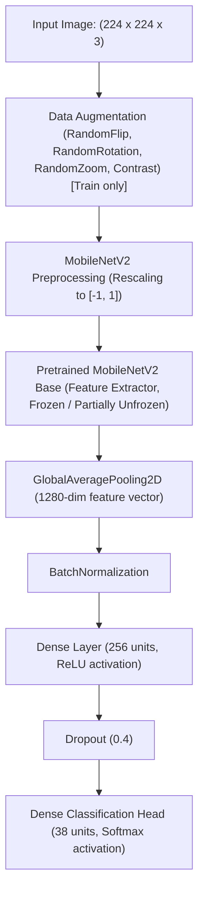

# Model Methodology: MobileNetV2 Transfer Learning

## 1. Transfer Learning Rationale

For resource-constrained edge/field scenarios and mobile deployment in urban biodiversity monitoring, **MobileNetV2** (Sandler et al., 2018) is selected as the primary backbone.

### Architectural Advantages:
1. **Inverted Residual Blocks**: Uses depthwise separable convolutions with inverted bottleneck structures, drastically reducing parameters ($\sim 3.4\text{M}$ base parameters) while maintaining high representation capability.
2. **Computational Efficiency**: Achieves low latency on mobile/CPU architectures and allows real-time inference on edge devices during field surveys.
3. **Pretrained Feature Extraction**: Initialized with ImageNet-1k weights, transferring low- and mid-level feature representations (edges, textures, leaf contours, bark textures).

---

## 2. Model Architecture Block Diagram

---

## 3. Training Protocol (Google Colab Execution)

The training procedure is designed in two stages:

### Stage 1: Feature Extraction (Transfer Learning)
- **Base Model**: MobileNetV2 base weights frozen (`base_model.trainable = False`).
- **Optimizer**: Adam ($\text{lr} = 1\times 10^{-3}$).
- **Loss**: Categorical Crossentropy / Sparse Categorical Crossentropy.
- **Epochs**: 10–15 epochs.
- **Callbacks**:
  - `ModelCheckpoint` monitoring `val_loss` (saving best weights only).
  - `EarlyStopping` (patience = 5).
  - `ReduceLROnPlateau` (factor = 0.2, patience = 3).

### Stage 2: Fine-Tuning (Optional / Recommended)
- **Unfreezing**: Unfreeze the top 30 layers of MobileNetV2 (`base_model.trainable = True`, freeze lower layers).
- **Optimizer**: Adam with reduced learning rate ($\text{lr} = 1\times 10^{-5}$).
- **Epochs**: 10–15 epochs.

---

## 4. Evaluation Metrics

Model performance is evaluated across:
1. **Overall Accuracy**: Micro-averaged prediction correctness across all test images.
2. **Class-Wise Precision, Recall, and F1-Score**: Evaluates performance per species to detect any bias caused by residual class imbalance.
3. **Confusion Matrix**: Visualizes inter-species misclassifications (e.g. between *Ficus benghalensis* and *Ficus religiosa*, or *Dalbergia latifolia* and *Dalbergia sissoo*).
4. **Dedicated Van Udyan Benchmark**: Evaluating the model strictly on authentic field photographs extracted from `Zone Wise Plants.xlsx` to measure real-world domain transfer.
